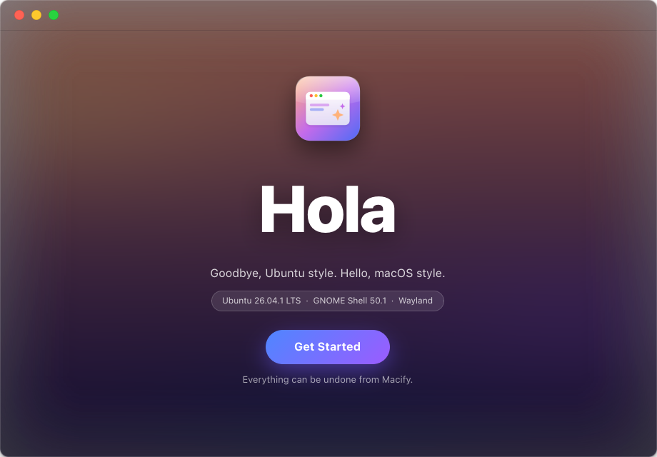
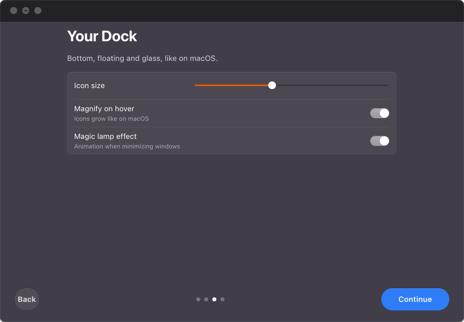
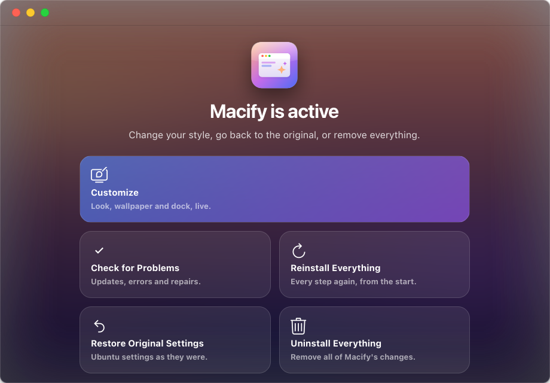
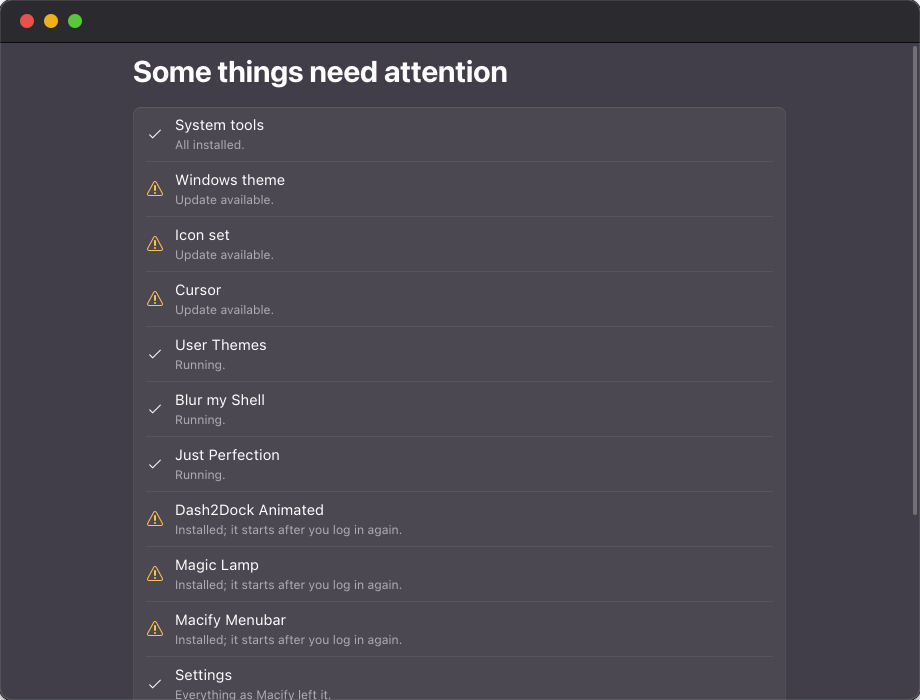

<p align="center">
  
</p>

<h1 align="center">Macify</h1>

<p align="center">A one-click macOS look for Ubuntu — from the boot screen to the dock. Fully reversible.</p>

<p align="center"><a href="https://jdswe.github.io/macify/"><b>Website</b></a> · <a href="https://jdswe.github.io/macify/#demo"><b>Watch the demo</b></a> · <a href="../../releases/latest"><b>Download</b></a></p>

<p align="center">
  
</p>

## Features

- **Boot and login** — the progress bar tracks real startup (“Welcome”) and shutdown (“See you soon”); macOS-style login.
- **Windows** — traffic-light buttons and macOS title bars, light or dark.
- **Menu bar** — File, Edit, View, Window and Help menus that work in any app, laid out like Apple's guidelines. Battery (with Energy Mode), Bluetooth (only on computers that have it), Wi‑Fi and Sound (output and microphone; above 100 % when over‑amplification is on) each open their own menu; Control Center keeps only the rest: Airplane Mode, Do Not Disturb, brightness, Dark Style and Night Light.
- **macOS touches** — volume, brightness and microphone appear as a glass card at the top right; the calendar marks today in red; Alt+Tab and the display switcher (Super+P) are glass panels; the music bars move while something plays; hover a Dock icon to see the app's windows as thumbnails and its recent files (open them or copy them to paste anywhere); windows never hide under the menu bar; Super+V opens a clipboard history (text, in memory only) and pastes your pick.
- **Live Activities** — a bubble at the top for music, charging and connection changes. Click it for Now Playing: cover, progress, controls, volume and the choice of source.
- **Dock** — floating glass, magnification, bounce, magic-lamp minimize and red notification badges.
- **Icons** — macOS icon set; missing icons are generated in the macOS shape.
- **Wallpapers, light and dark** — eight original folded-glass wallpapers, each in a light and a dark version — pick the one you like; it stays when you switch appearance. Your own folders become sections of the gallery. Changing the wallpaper also updates the login screen (one password), without reinstalling.
- **One look** — the accent color, the dock's glass and the menu bar text (dark over light wallpapers) follow your wallpaper and appearance; switching Dark Style in Control Center switches windows, menus, bar and dock together — your wallpaper stays.
- **Customize** — change look, wallpaper and dock live, without reinstalling.
- **Doctor** — finds outdated or broken pieces and fixes them.
- **Software Update** — checks GitHub and installs new versions from inside the app. An update applies only what changed (new settings, a newer theme or extension) and cleans up old files — nothing is reinstalled.
- **Every app type** — traffic-light buttons in apt, Flatpak and snap GTK apps, including ones you install later.
- **Clean removal** — restore or uninstall everything in one click.

<p align="center">
  
</p>

## Install

```bash
curl -fsSL https://jdswe.github.io/macify/install.sh | bash
```

Or download the `.deb` from [Releases](../../releases/latest) and run `sudo apt install ./macify_*_all.deb`.

Open **Macify**, follow the steps, press **Install** and restart.

Built for Ubuntu with GNOME 45–50. Tested on Ubuntu 26.04.1 (GNOME 50, Wayland).

## Screenshots

| Dock, live preview | Manage |
|---|---|
|  |  |
| **Doctor** | **Boot** |
|  |  |

## Command line

```bash
macify install --dry-run   # preview every change
macify doctor --fix        # check for problems and fix them
macify uninstall           # remove everything
```

More in the [guide](docs/GUIDE.md).

## Security

Everything runs as your user except the startup and login screens, which use one administrator password (pkexec) for a small packaged helper. That helper only runs code from root-owned folders, reads your files with your own permissions, accepts only images and text of limited size, and installs a pinned WhiteSur version whose SHA‑256 is checked before anything runs. The GNOME extensions it installs are pinned to tested versions and checked against their SHA‑256 too. Updates are verified against the fingerprint GitHub publishes, and nothing is installed without one. The installed files are writable only by root. Macify opens no network ports, runs no system services and loads no kernel modules.

## Development

```bash
python3 -m unittest discover -s tests                    # unit tests (seconds)
MACIFY_SHELL_TESTS=1 python3 -m unittest tests.test_shell # real GNOME Shell, 7 monitor layouts
scripts/build_deb.sh                                      # dist/macify_<version>_all.deb
scripts/make_wallpapers.py                                # regenerate the bundled wallpapers
```

The shell tests start a hidden, isolated GNOME Shell (its own bus and settings), open real apps and check every menu, the status menus, Now Playing, the dock and its badges on one, two and three monitors at scales from 1 to 2.

## Credits

© 2026 Jose David Carranza Angarita · [GPL-3.0](LICENSE).

Built on [WhiteSur](https://github.com/vinceliuice/WhiteSur-gtk-theme) by vinceliuice and GNOME extensions from [extensions.gnome.org](https://extensions.gnome.org). Apple fonts are never bundled. Not affiliated with Apple or Canonical.
