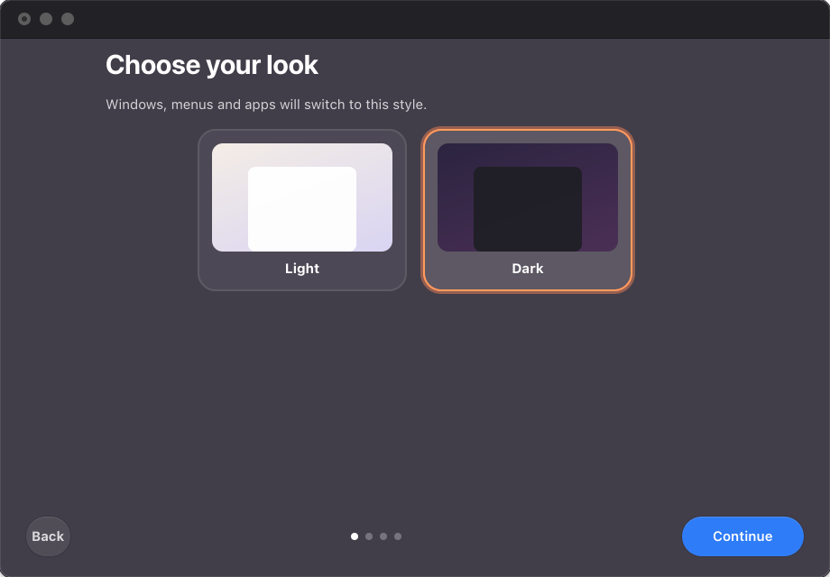

<p align="center">
  
</p>

<h1 align="center">Macify</h1>

<p align="center">A one-click macOS look for Ubuntu — from the boot screen to the dock. Fully reversible.</p>

<p align="center">
  
</p>

## Features

- **Boot and login** — black boot screen with a progress bar, macOS-style login.
- **Windows** — traffic-light buttons and macOS title bars, light or dark.
- **Menu bar** — transparent, with a system menu and the active app's name.
- **Dock** — floating glass, magnification, bounce and magic-lamp minimize.
- **Icons** — macOS icon set; missing icons are generated in the macOS shape.
- **Wallpaper colors** — the accent color follows your wallpaper.
- **Customize** — change look, wallpaper and dock live, without reinstalling.
- **Doctor** — finds outdated or broken pieces and fixes them.
- **Clean removal** — restore or uninstall everything in one click.

<p align="center">
  
</p>

## Install

Download the `.deb` from [Releases](../../releases/latest), then:

```bash
sudo apt install ./macify_*_all.deb
```

Open **Macify**, follow the steps, press **Install** and restart.

Built for Ubuntu with GNOME 45–50. Tested on Ubuntu 26.04 (GNOME 50, Wayland).

## Screenshots

| Appearance | Dock |
|---|---|
|  |  |
| **Doctor** | **Boot** |
|  |  |

## Command line

```bash
macify install --dry-run   # preview every change
macify doctor --fix        # check for problems and fix them
macify uninstall           # remove everything
```

More in the [guide](docs/GUIDE.md).

## Credits

Built on [WhiteSur](https://github.com/vinceliuice/WhiteSur-gtk-theme) by vinceliuice and GNOME extensions from [extensions.gnome.org](https://extensions.gnome.org). Apple fonts are never bundled. Not affiliated with Apple or Canonical.
